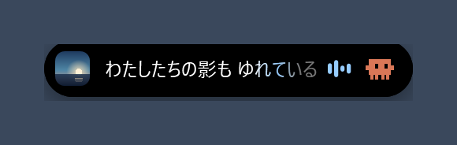
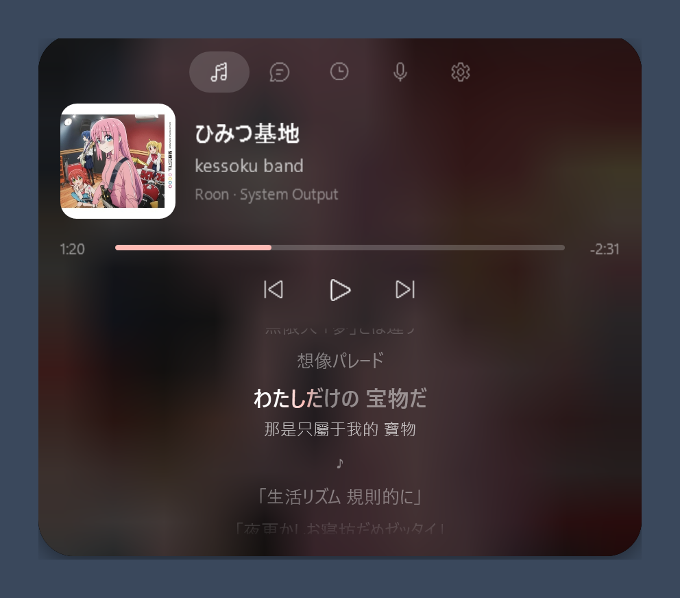

# Shima

[繁體中文](../README.md) · **简体中文** · [English](README.en.md) · [日本語](README.ja.md) · [한국어](README.ko.md) · [Español](README.es.md) · [Français](README.fr.md) · [Deutsch](README.de.md) · [Português](README.pt.md) · [Italiano](README.it.md) · [Русский](README.ru.md)

Windows 屏幕顶端的一座小岛：显示正在播放的音乐和同步歌词，鼠标移上去展开成播放面板。

## 功能

- **音乐来源**：Roon（进度、音量、播放区域），以及任何会出现在 Windows 音量面板的播放器——浏览器里的 YouTube、Spotify、Apple Music 等
- **歌词**：自己的 `.lrc`、LRCLIB、网易云、QQ 音乐、酷狗；能分辨同一首歌的不同版本（`104期Ver.`、`SAKURA Ver.`）
- **动态歌词**：整份歌词平滑滚动，光跟着演唱进度扫过；点任意一句即可跳转；可换来源、微调时间
- **歌词第二行**：日文歌下方显示中文翻译或罗马音
- **小角色**：住在胶囊里，跟着实际的声音跳；默认是向 Claude Code 吉祥物致敬的像素小 Claude
- **Discord 状态**：显示正在听的歌、封面与进度
- **工具**：番茄钟、文件暂存架、待办清单、月历、喝水提醒
- **系统状态**：音量、亮度、电量、网络、播放设备变化时显示在岛上
- **问 Claude**：打字或语音提问，还能帮你切歌
- **Claude Code**：权限请求显示在岛上，可允许或拒绝；显示任务进度，完成时通知
- **聊天**：把 Claude、Gemini、ChatGPT 的网页版放进岛里
- 可拖到任意位置；全屏程序在前台时自动隐藏；11 种界面语言

## 安装

到 [Releases](../../../releases) 下载 `Shima.exe`，双击运行，无需另外安装 .NET。

程序没有代码签名，Windows 第一次会弹出 SmartScreen 警告，点「更多信息 → 仍要运行」。

使用 Roon 的话，第一次运行后到 Roon「设置 → 扩展」启用 **Shima**。

## 快捷键

| | |
| --- | --- |
| Ctrl+Alt+Space | 展开／收起 |
| Ctrl+Alt+V | 向语音助手提一个问题 |

系统托盘的图标可以隐藏小岛或退出。展开后最右边的齿轮是设置。

## 更多

设置项、自行构建与翻译方式请见 [English](README.en.md) 或 [繁體中文](../README.md) 的完整说明。

Claude 是 Anthropic 的商标；岛上的 Claude 角色是致敬之作，本项目与 Anthropic 无关。

MIT © 2026 Carinoasd
